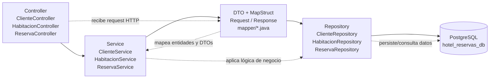

# Arquitectura por capas y endpoints en vivo

Esta documentación complementa el proyecto sin tocar lo que ya existe. Aquí se deja de forma explícita la capa de arquitectura actual y los endpoints activos del backend.

## Diagrama de capas



### Descripción de la arquitectura

- Controller: expone los endpoints REST y recibe las peticiones HTTP.
- Service: concentra la lógica de negocio y coordina validaciones y operaciones.
- DTO + MapStruct: separan la capa de entrada/salida de la entidad JPA y evitan exponer directamente el modelo de dominio.
- Repository: abstrae el acceso a datos usando Spring Data JPA.
- PostgreSQL: base de datos relacional donde quedan almacenados clientes, habitaciones y reservas.

## Endpoints actuales en vivo

### Base URL local

Por defecto, la aplicación Spring Boot queda disponible en:

- `http://localhost:8080`

La base de datos PostgreSQL configurada es:

- `jdbc:postgresql://localhost:5432/hotel_reservas_db`
- usuario: `postgres`
- contraseña: `postgres`

### Clientes

| Método | Ruta | Descripción |
| --- | --- | --- |
| POST | `/api/clientes` | Crea un cliente |
| GET | `/api/clientes` | Lista todos los clientes |
| GET | `/api/clientes/{id}` | Obtiene un cliente por ID |
| GET | `/api/clientes/{id}/resumen` | Obtiene el resumen del cliente con sus reservas |
| PATCH | `/api/clientes/{id}` | Actualiza parcialmente nombre y email |

#### Ejemplo de creación de cliente

```bash
curl -X POST http://localhost:8080/api/clientes \
  -H "Content-Type: application/json" \
  -d '{
    "nombre": "Ana García",
    "email": "ana@hotel.com"
  }'
```

#### Ejemplo de resumen de cliente

```bash
curl http://localhost:8080/api/clientes/{id}/resumen
```

### Habitaciones

| Método | Ruta | Descripción |
| --- | --- | --- |
| GET | `/api/habitaciones` | Lista habitaciones y suites |
| POST | `/api/habitaciones/suites` | Crea una suite presidencial |

#### Ejemplo de creación de suite

```bash
curl -X POST http://localhost:8080/api/habitaciones/suites \
  -H "Content-Type: application/json" \
  -d '{
    "numero": "P-101",
    "precioPorNoche": 350.0,
    "capacidadMaxima": 4,
    "incluyeMayordomo": true,
    "jacuzziPrivado": true
  }'
```

### Reservas

| Método | Ruta | Descripción |
| --- | --- | --- |
| POST | `/api/reservas` | Crea una reserva |
| GET | `/api/reservas` | Lista todas las reservas |
| GET | `/api/reservas/{id}` | Obtiene una reserva por ID |

#### Ejemplo de creación de reserva

```bash
curl -X POST http://localhost:8080/api/reservas \
  -H "Content-Type: application/json" \
  -d '{
    "clienteId": "<UUID-del-cliente>",
    "habitacionId": "<UUID-de-la-habitacion>",
    "fechaInicio": "2026-11-10T15:00:00",
    "fechaFin": "2026-11-12T12:00:00"
  }'
```

## Mapeo real del proyecto

La estructura del proyecto refleja esta arquitectura:

- `src/main/java/com/hotel/Hotel/controller/` → controladores REST
- `src/main/java/com/hotel/Hotel/service/` → lógica de negocio
- `src/main/java/com/hotel/Hotel/dto/` → DTOs de request/response
- `src/main/java/com/hotel/Hotel/mapper/` → interfaces/mapas de MapStruct
- `src/main/java/com/hotel/Hotel/repository/` → repositorios JPA
- `src/main/java/com/hotel/Hotel/domain/` → entidades de negocio

## Resumen visual

```text
Controller
   ↓
Service
   ↓
DTO / MapStruct
   ↓
Repository
   ↓
PostgreSQL
```

Con esta estructura, la API queda completamente organizada en capas y lista para crecer sin romper la separación de responsabilidades.
