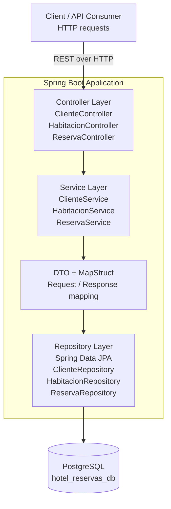

# HotelSpringBoot

API REST de reservas de hotel con Spring Boot, JPA, PostgreSQL y MapStruct.

## Ejecución

El perfil por defecto usa PostgreSQL, configurado en `src/main/resources/application.properties`.

Para desarrollo local sin acceso a PostgreSQL, usa el perfil `dev`, que persiste los datos en H2 mediante un archivo local:

```bash
mvn spring-boot:run -Dspring-boot.run.profiles=dev
```

El perfil `dev` habilita la consola H2 en `http://localhost:8080/h2-console` y crea de forma idempotente un cliente, una habitación estándar, una suite y dos reservas. Los UUID y los totales se imprimen en consola al iniciar la aplicación; al reejecutarse, el seed mantiene datos consistentes y evita duplicaciones innecesarias.

### Conexión desde DBeaver mientras la aplicación corre

El perfil `dev` usa H2 en modo archivo compartido. En DBeaver selecciona el driver H2 y utiliza la misma URL, reemplazando la ruta relativa por la ruta absoluta de este proyecto:

```text
jdbc:h2:file:C:/ruta/al/proyecto/HotelSpringBoot/data/hotel-db;AUTO_SERVER=TRUE
```

Usuario: `sa`. Contraseña: vacía. En H2 2.2.x no se debe combinar `AUTO_SERVER=TRUE` con `DB_CLOSE_ON_EXIT=FALSE`, porque esa combinación es rechazada por el motor; por eso el perfil `dev` configura el modo seguro para compartir la base entre Java y DBeaver.

## Endpoints principales

- `GET /api/habitaciones`: lista habitaciones estándar y suites con el campo discriminador `tipo`.
- `POST /api/habitaciones/suites`: crea una suite y responde `201 Created` con `Location`.
- `GET /api/clientes/{id}/resumen`: devuelve el resumen agregado y sus reservas sin ciclos de serialización.
- `PATCH /api/clientes/{id}`: actualiza únicamente `nombre` y `email`, ignorando los campos internos del cliente.

Las cuatro solicitudes del taller están documentadas en `solicitudes-avanzadas.http`. Sustituye `clienteId` por el UUID que imprime el seed del perfil `dev`.

También se incluye la colección `HotelSpringBoot-Taller7.postman_collection.json`, lista para importarse en Postman. Usa `http://localhost:8081` y ejecuta las seis solicitudes en orden; contiene endpoint de clientes, habitaciones y reservas con JSONs listos para probar.

## Architecture & System Topology



### Topology Notes
- The client interacts with the application through the REST API exposed by the controller layer.
- Business logic is isolated in the service layer to preserve separation of concerns and maintainability.
- DTOs and MapStruct centralize the data transformation between the API contract and the domain entities.
- Persistence is delegated to the repository layer using JPA, keeping the business code independent from the database implementation details.
- PostgreSQL acts as the durable data store for clients, rooms, and reservations, while the application remains decoupled from persistence concerns.

### Architecture Summary
- Entry point: `Controller`
- Business logic: `Service`
- Contract mapping: `DTO / MapStruct`
- Data access: `Repository`
- Persistence layer: `PostgreSQL`
- Design principle: separation of concerns and clean layered architecture
