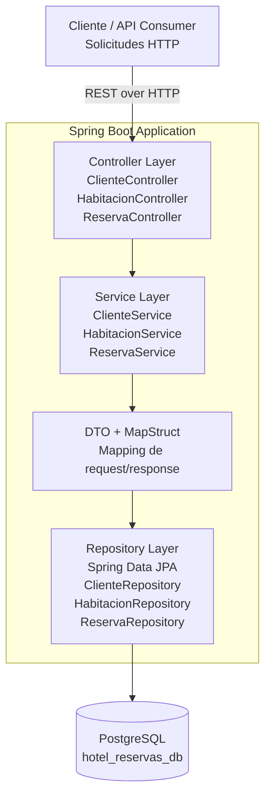

# HotelSpringBoot

API REST para gestión de reservas de hotel implementada con Spring Boot, JPA, PostgreSQL y MapStruct.

## Autoría y portafolio

- Portfolio: https://oskar-ortiz.vercel.app
- GitHub: https://github.com/oskar-ortiz

## Visión arquitectónica empresarial



### Principios de diseño
- Separación clara entre API, lógica de negocio y persistencia.
- La capa de servicio centraliza las reglas de negocio para clientes, habitaciones y reservas.
- DTO y MapStruct evitan que la capa de acceso a datos contamine el contrato HTTP.
- PostgreSQL funciona como base relacional duradera para operar transacciones del negocio hotelero.
- El diseño prioriza mantenibilidad, testabilidad y frontera arquitectónica limpia.

## Ejecución

El perfil por defecto usa PostgreSQL, configurado en `src/main/resources/application.properties`.

Para desarrollo local sin acceso a PostgreSQL, usa el perfil `dev`, que persiste los datos en H2 mediante un archivo local:

```bash
mvn spring-boot:run -Dspring-boot.run.profiles=dev
```

El perfil `dev` habilita la consola H2 en `http://localhost:8080/h2-console` y crea de forma idempotente un cliente, una habitación estándar, una suite y dos reservas. Los UUID y los totales se imprimen en consola al iniciar la aplicación; al reejecutarse, el seed mantiene datos consistentes y evita duplicaciones innecesarias.

### Conexión desde DBeaver mientras la aplicación corre

El perfil `dev` usa H2 en modo archivo compartido. En DBeaver selecciona el driver H2 y utiliza la misma URL, reemplazando la ruta relativa por la ruta absoluta de este proyecto:

```text
jdbc:h2:file:C:/ruta/al/proyecto/HotelSpringBoot/data/hotel-db;AUTO_SERVER=TRUE
```

Usuario: `sa`. Contraseña: vacía. En H2 2.2.x no se debe combinar `AUTO_SERVER=TRUE` con `DB_CLOSE_ON_EXIT=FALSE`, porque esa combinación es rechazada por el motor; por eso el perfil `dev` configura el modo seguro para compartir la base entre Java y DBeaver.

## Endpoints principales

- `GET /api/habitaciones`: lista habitaciones estándar y suites con el campo discriminador `tipo`.
- `POST /api/habitaciones/suites`: crea una suite y responde `201 Created` con `Location`.
- `GET /api/clientes/{id}/resumen`: devuelve el resumen agregado y sus reservas sin ciclos de serialización.
- `PATCH /api/clientes/{id}`: actualiza únicamente `nombre` y `email`, ignorando los campos internos del cliente.

Las cuatro solicitudes del taller están documentadas en `solicitudes-avanzadas.http`. Sustituye `clienteId` por el UUID que imprime el seed del perfil `dev`.

También se incluye la colección `HotelSpringBoot-Taller7.postman_collection.json`, lista para importarse en Postman. Usa `http://localhost:8081` y ejecuta las seis solicitudes en orden; contiene JSONs listos para probar clientes, habitaciones y reservas.

## Capas y responsabilidades

- Capa de entrada: `Controller`
- Lógica de negocio: `Service`
- Transformación de contrato: `DTO / MapStruct`
- Acceso a datos: `Repository`
- Persistencia: `PostgreSQL`

## Requisitos técnicos

- Java 17
- Maven
- PostgreSQL (perfil por defecto)
- H2 (perfil `dev` para desarrollo local)
